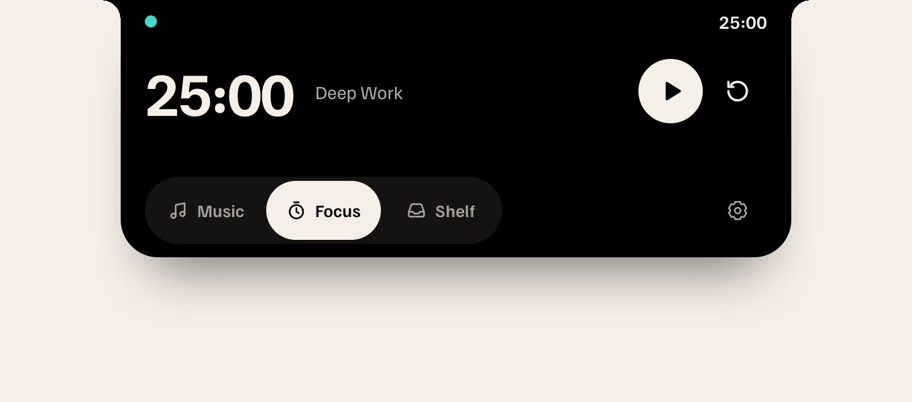

# Lilt



Lilt is a local macOS app for music, focus and files, designed around the camera notch. Its interface and motion are adapted from [Lilt, a study by Vayun Godara](https://vayun.net/studies/lilt/), with permission.

## Download

[Download the latest beta](https://github.com/Thimorrow/Lilt/releases) for macOS 15 or later. The release includes a universal app for Apple silicon and Intel Macs.

1. Open the DMG and drag **Lilt.app** to Applications. Alternatively, extract the ZIP and copy the app to Applications.
2. Open Lilt from Applications. It appears at the top of the screen and in the menu bar, not in the Dock.
3. The beta is ad-hoc signed and **not notarized by Apple**. If macOS blocks its first launch, check that the download came from this repository, then use **System Settings → Privacy & Security → Open Anyway**. See [Apple's instructions](https://support.apple.com/en-us/102445) and the [installation guide](docs/INSTALL-BETA.txt).

This is an early beta. The Intel build has not been tested on an Intel Mac, and real Spotify playback, trackpad gestures, external displays, AirDrop and long-running sessions need further testing. The download does not include the [optional Meld Android integration](CONTRIBUTING.md#optional-meld-integration).

## Use Lilt

Click the compact notch or press your keyboard shortcut (⌃⌥L by default) from any app to open it. Use the Music, Focus and Shelf tabs, or swipe horizontally on a trackpad. Click outside Lilt, an empty part of the open panel, or press Escape to close it. Click the gear, use the menu-bar icon, or press ⌘, to open settings. **General** controls the display, opening at login and the shortcut. Click the shortcut to record a new combination; Escape cancels. A conflicting combination leaves the previous shortcut in place.

### Music

Choose Spotify or Apple Music in settings, install and open that Mac app, and select a track there. **Connect** explicitly asks macOS for permission to control the selected player. Checking the connection does not start playback. Playback and track information come from the selected app; Lilt does not use global media keys or store account credentials.

### Focus

Focus works as a standalone timer. Click the time to choose a preset, a custom duration or work and break intervals. Each interval transition requires you to start the next phase. When time is up, choose the next interval, add **+5** minutes or **End** the session. **+5** also extends a running or paused timer; paused timers stay paused. A sound plays when time is up; turn it off in settings. **Notification** under **When time is up** separately enables a macOS notification after you explicitly grant permission. A running timer continues while the notch is closed and restores its deadline after an app restart.

Brain.fm is optional and disabled on new installations. When enabled, Lilt controls the separately installed Brain.fm app using macOS Accessibility permission. Lilt confirms playback before starting the associated work timer. A break does not start music automatically. If Lilt is fully closed at the end of a session, it cannot pause Brain.fm until it runs again.

### Shelf

Drag files or folders into Shelf, use **Add**, or copy them in Finder and press **⌘V** in Shelf. **Paste** provides the same action. Lilt stores local references, not copies. Select multiple files with ⌘-click or a range with ⇧-click. The context menu provides preview, open and Finder actions for a single file, and sharing, longer retention and removal for a selection. Selected files and folders can be dragged out together. **⌘Z** or **Undo** restores removed entries, including a cleared Shelf, until Lilt quits. Expired entries stay expired; original files are never restored or modified by Undo.

New references expire after seven days by default. **Keep Longer** starts a new 30-day period. Both defaults can be changed in settings; changes do not alter existing deadlines. Removing or expiring a reference never deletes the original file. Older entries without a deadline remain until removed.

### Experimental notification banners

In **Settings → General**, notification banners are explicitly opt-in and off by default, independently of Brain.fm Accessibility access. **Preview synthetic banner** works without capture permission. It shows one temporary plaintext banner using the existing notch animation; Dismiss, Escape or an outside click clears it. Selecting a tab takes over the panel without an expiry closing it.

Real capture is currently blocked by an **unsupported/unverified Notification Center layout**. Lilt does not read notification content or history. Opening Accessibility settings is a separate explicit action and does not establish layout support. The intended capture target is only `com.apple.notificationcenterui`, using public Accessibility APIs, with no database, private API, Full Disk Access or screenshots. Diagnostic/smoke runs never capture, request notification permissions or open permission settings, even with opt-in saved. Session inactivity and sleep suspend the owner; complete lock-screen safety is not verified.

## Build from source

Requires macOS 15 or later, Xcode/Swift and Node.js. CI uses Node.js 24. This build does not require Android:

```sh
git clone https://github.com/Thimorrow/Lilt.git
cd Lilt
LILT_BUILD_MELD=0 LILT_SIGN_IDENTITY=- ./scripts/build-app.sh
open build/Lilt.app
```

The command uses an ad-hoc signature. macOS permissions can need to be granted again after a rebuild. To retain an existing development identity, follow [CONTRIBUTING.md](CONTRIBUTING.md) and do not replace it with an ad-hoc signature.

## Tests

```sh
swift test
node --test scripts/test-ui.mjs scripts/test-focus.mjs scripts/test-settings.mjs scripts/test-notifications.mjs
bash -n scripts/build-app.sh scripts/build-meld-bridge.sh
git diff --check
```

Automated tests and simulated players do not prove real playback, trackpad or hardware behavior. Diagnostic modes support isolated test data; see [CONTRIBUTING.md](CONTRIBUTING.md) and [docs/BRIDGE.md](docs/BRIDGE.md). Never stop another running Lilt instance merely to run a test.

## Project

AppKit owns windows, permissions, local storage and player control. Bundled WKWebViews render the interface; Lilt does not load a remote website. Normal settings, timer state and file references are stored locally in `~/Library/Application Support/Lilt/`.

- [Contributing](CONTRIBUTING.md) · [Security](SECURITY.md) · [Release process](docs/RELEASING.md)
- [Native/UI bridge](docs/BRIDGE.md) · [Design reference](docs/REFERENCE.md) · [Feature plan](docs/FEATURE-PLAN.md)
- [Credits and third-party licences](THIRD_PARTY_NOTICES.md) · [MIT licence](LICENSE)

The application code is MIT licensed. Familjen Grotesk remains under the SIL Open Font License 1.1. Lilt is not an official product of Spotify, Apple, Brain.fm or Meld.
